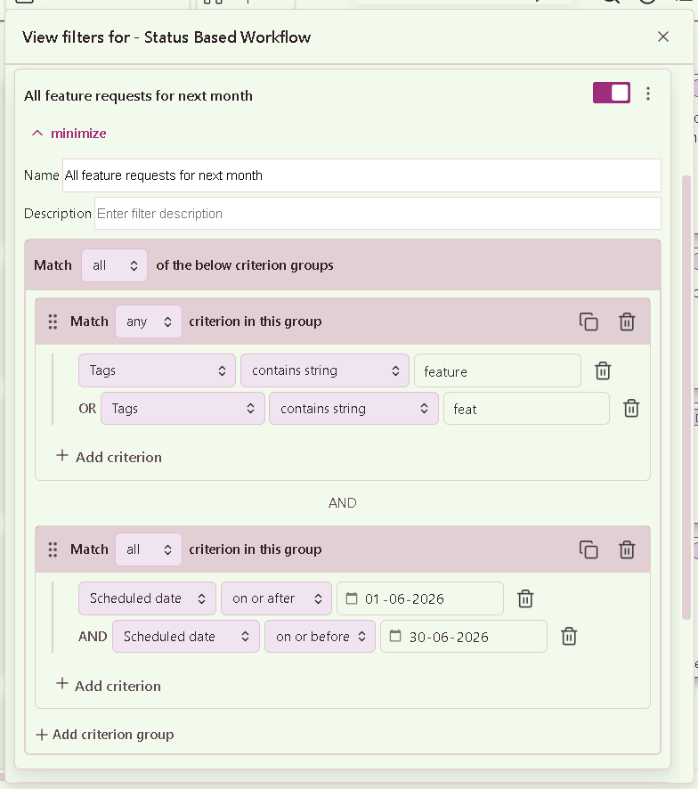

# Advanced Filter Menu
{: .d-inline-block }
v2.0.0 (under development)
{: .label .label-blue }

This is a very powerful filter which you can use for the following components inside this plugin : 
- [Board](/docs/Features/Advanced_Board_Filter.md)
- [View](/docs/Features/Advanced_Board_Filter.md)
- [Kanban Column](/docs/Features/Advanced_Column_Filter.md) (Only applicable for [Kanban view](/docs/Components/Views/Kanban_View.md))

{: .note }
> This Advanced Filter Menu should open as a **Closable popover** on desktop screen.
> 
> But depending on your device and screen resolution, this component may present itself as a modal. 

In the below image example you can see that, this component has been presented as a floating window for view-level advanced filter : 

Also, after you have made any changes to the filter configs, you dont have to click on any save button. Simply close this component and your configurations will be applied to the board/view/column for which you have opened this feature.

## Sections

To understand this complete UI, we will traverse through each of the component, by moving from outer shell to inner shell.

### Condition to combine **Quick Filters**

The First thing you will notice on very top, right after the heading of this window is the section which has a drop-down input element with three options : "any", "all" and "none". Each of this three options corresponds to the Boolean logic operator mapped as below : 
- any <=> `OR`
- all <=> `AND`
- none <=> `NOT`

These boolean operators helps us to combine multiple quick filters together to form a bigger complete logic.

### Quick Filter

When you will open this Advanced filter menu window, you should see your quick filters in a list view like this : 

Each of the list element will show : 
- **The name of the filter**
- **The description** : If you have entered any.
- **A toggle button** : This will allow you to toggle the quick filter ON or OFF.
- **A menu button** : This open a menu which will have three options : 
  - **Duplicate filter**: Allows you to duplicate the quick filter, to easily create more filters.
  - **Save in warehouse** : This will save/store this quick filter inside the [Filters warehouse](/docs/Features/Advanced_Filter/Filters_Warehouse.md).
- **Expand to edit** : This is a text button, which will show or hide the configurations of the quick filter, so you can edit it in this same UI.

When you will expand the configuration of any one of the quick filter, the UI will look like this :

In the configuration section, first, there will be two text input fields for you to enter the name and the description of this quick filter respectively.

#### Condition to combine **Quick Filters**

Next, you will find the the section which will allow you to change the "Condition to combine multiple criterion groups". This is similar to the one we saw for combining multiple quick filters. This will also have the a drop-down menu with three options to choose the respective boolean operator "AND", "OR", "NOT".

And inside this section, now you can add Criterion groups using the "**Add criterion group**" button.

### Criterion Group

The additional feature of this Advanced filter is that, you can group multiple criterion together to form a Criterion group. This helps in building complex logic which you might need to find specific tasks on your board, view or column.

You can delete the whole Criterion group using the delete icon button, which you will see inside the header at top right inside each criterion group.

As well as, if you have a very big and complex criterion group and you like to duplicate that it based. You can do the same using the **Duplicate Criterion Group Button** which will be present just besides the delete icon button.

### Criterion

This is the basic, ground-level, building-block for constructing an Advanced filter. This tells the complete filter : 
- What kind of criterion to be used
- On which task property it should be used
- And how it should be used

You can apply a criterion on various properties of the task. To add a new criterion, you should have atleast one [Criterion group](#criterion-group) inside your quick filter, because a criterion is not possible to be created directly inside a quick filter. Its not necessary that you should have multiple criterion group inside the quick filter, but to even add a single criterion, we must add it inside a criterion group.

To add a new criterion, click on the **➕ Add criterion** button which you will see inside the criterion group section at the bottom left, as shown in the above example image.

When a new criterion is created, you will need to configure the following characteristics : 
- **Property :** (Drop-down) This will be the property of the task on which you want to apply a filter-rule.
- **Condition :** (Drop-down) How this property should be used to filter your tasks.
- **Value :** (Drop-down or Text box) Based on the condition you have selected, in this field you will be prompted to enter/select a value.

You can delete a single criterion using the delete icon button.

### Buttons Section

At the bottom, there will be two buttons aligned on either side of this window.

#### **Add filter**

This button will simply add/create a new [Quick filter](#quick-filter). To keep the UI clean and also to keep conversation simpler, we will often refer a "Quick filter" as simply "Filter", which makes sense, since we can add multiple filters inside the ["Advanced filter" feature](/docs/Features/Advanced_Filter/index.md).

#### **Import filters**

Another very nice feature, provided as a part of this Advanced filter is to allow to store your Quick filters inside a vault level storage, so that you can re-use those quick filters for your other boards, views or columns.

When you will click on this button, a new modal will open for you to select one or more saved quick filters. Read more about this modal, its features and its UI here : [Filters Warehouse](/docs/Features/Advanced_Filter/Filters_Warehouse.md).